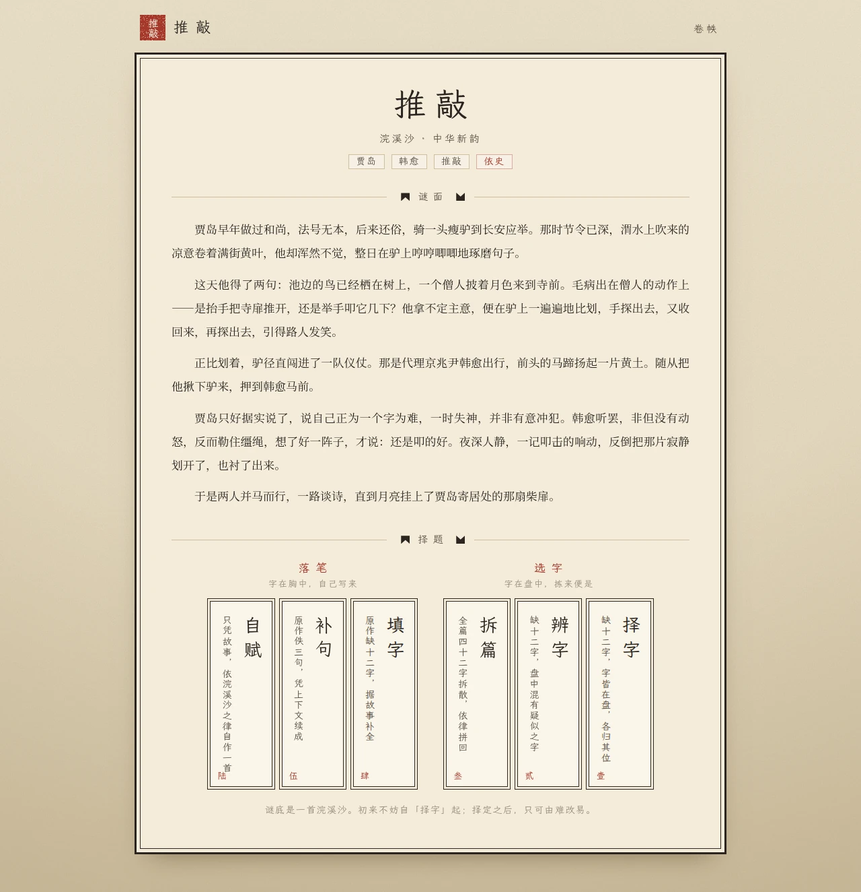

# 推敲

> 鸟宿池边树，僧敲月下门。

一款由大模型出题的诗词小游戏。你说出一个或几个人物、事件，模型据此写一段背景故事（谜面）和一首格律诗词（谜底）；你在本地网页上读故事，填字、补句，或者干脆自己赋一首，最后揭晓模型的原作，看它如何评点你的推敲。

<table>
  <tr>
    <td width="33%" valign="top"></td>
    <td width="33%" valign="top"></td>
    <td width="33%" valign="top"></td>
  </tr>
  <tr>
    <td align="center">开局：读谜面，择难度</td>
    <td align="center">局中（辨字）：拣字落格，「试」后圈为字合、抹为未合</td>
    <td align="center">结束：品第、评点，揭晓原作对照</td>
  </tr>
</table>

示范局：贾岛、韩愈、推敲，浣溪沙，中华新韵。

三个部件：

| 部件 | 位置 | 做什么 |
| --- | --- | --- |
| SKILL | `skill/tuiqiao/SKILL.md` | 教 harness 里的模型怎么提问、创作、建局、评点 |
| CLI | `bin/tuiqiao.js` | 格律校验、建局、起停本地服务、等交卷、回写评点 |
| 网页 | `web/` | 读谜面、选难度、逐格填词、看朱批、揭晓原作 |

Node ≥ 18，零依赖，无构建步骤。

## 开始

把下面这段交给你的 agent，它会给自己装上 SKILL，然后陪你开一局：

~~~text
请为你自己装上「推敲」这个 skill：先取得仓库（已有就跳过）
git clone https://github.com/Glasden/TuiQiao.git
再在仓库根目录运行
node bin/tuiqiao.js skill install <你的 harness 加载 skill 的目录>
（Claude Code 可省略目录，默认装到 ~/.claude/skills）。
装好后若本会话还没加载上它，就直接读装好的 SKILL.md，照它的流程陪我开一局推敲。
~~~

也可以自己装：

~~~sh
node bin/tuiqiao.js skill install            # 把 SKILL 装进 ~/.claude/skills（可另给目录）
~~~

然后在任何能加载 skill 的 harness 里说一句「来一局推敲」，再报上你想写的人与事。模型会问你取向（依史实 / 改写）、体裁、韵书，随后给你一个本地链接。

想直接用命令行：`npm link` 之后即有 `tuiqiao` 命令，`tuiqiao --help` 列出全部用法。

## 玩法

两大档，各三小档，由易到难：

**选字**——字在盘里，拣来落格，不用打字（点字落格，或直接拖放）：

- **择字**：原作缺若干字，缺的字都在字盘里，各归其位。
- **辨字**：同上，只是盘里另混了几个似是而非的干扰字。
- **拆篇**：全篇的字都拆散在盘里，依格律拼回原作；长篇分成几盘，律诗一联一盘。

**落笔**——字要自己写：

- **填字**：原作缺若干字，据故事补全。
- **补句**：原作佚去约一半的句子，凭上下文续成。
- **自赋**：只凭故事，依所选体裁的格律自作一首，边写边校平仄与韵脚。

选字三档直接亮出平仄谱，盘上每枚字的字角也注着它的平仄：哪个字放得进哪一格，先看格律。

择定难度后只可由难改易。可以讨提示：**示律**（标出平仄与韵位）、**揭字**、**句意**、**意象**，提示与试笔次数都计入品第。交卷后模型会送来评点，随后可揭晓原作与创作手记。

「试」之后的朱批（繁体与简体视为同字）：圈 = 字合；双点 = 韵合；单点 = 平仄合；三角 = 字在本句别处（仅补句档）；抹 = 未合。选字三档只有圈与抹。改过的格，批会抹去，但点回那一格，诗笺下方会列出它**曾试**过的字与当时的批，点一下可改回去。

案头有一册**查韵**：查任意字的平仄与韵部，不计次；自赋档还可以点韵部名，翻检同韵的常用字（填字、补句档不开放，免得韵脚空成了选择题）。

品第有两方印。**合原**按得分自动给，看的是与原作相合了几个字（自赋以外各档）；**诗品**由评点人给，看的是你写的句子本身（补句、自赋档）。补句档两方并列：原作是模型现写的，补得与它不同并不算错。

交卷后的页面可以直接打印或存成 PDF，谜面、诗笺、朱批、原作会排成一页线装书的样子。

## 格律

- 体裁：五绝、七绝、五律、七律，以及《钦定词谱》的八百余个词牌、曲牌（含变体）。谱库没有的体裁照样能玩，只是没有格律校验与提示。
- 韵书：**中华新韵**（依普通话，推荐）或**古韵**（诗依平水韵，词依词林正韵，入声归仄）。
- 判定从宽：多音字任一读音合律即算合；词的换韵按韵位平仄自动分组；宋人整韵通押的写法不判出韵。孤平、三平尾算错，三仄尾、首句借邻韵只作提醒。跨句拗救与对仗不在校验之列。

~~~sh
tuiqiao forms --sample 4                     # 随机四个常用体裁
tuiqiao form 浣溪沙                          # 看谱
tuiqiao check --form 七绝 --rhymebook xinyun 诗.txt
tuiqiao char 白月石客 --rhymebook guyun     # 查字：平仄、声、韵部
tuiqiao rhymes 七阳 --rhymebook guyun        # 查韵：同韵的常用字
~~~

## 运行细节

- 服务缺省监听 `127.0.0.1:7117`，端口被占则顺延；对局存在 `~/.tuiqiao/games/`。
- 环境变量：`TUIQIAO_PORT`、`TUIQIAO_HOST`、`TUIQIAO_PUBLIC_URL`（经隧道或端口转发访问时，覆盖对外展示的地址）、`TUIQIAO_HOME`。
- 网页的楷体与宋体从 jsDelivr 加载（霞鹜文楷、思源宋体）；离线时退回系统自带的楷体、宋体，功能不受影响。
- 谜底的保密靠 SKILL 的约束：能派子代理的 harness 由子代理创作并建局，主对话里不出现诗；不能派子代理时，谜底会出现在工具调用的参数里，别去展开它。

## 开发

~~~sh
npm test                                     # node --test，全部测试
node scripts/build-data.mjs                  # 从 .cache/sources/ 重建 data/（来源见 data/SOURCES.md）
~~~

接口契约见 `docs/DESIGN.md`。数据来源与许可见 `data/SOURCES.md`。

## 友情链接

- [**LINUX DO**](https://linux.do) — 新的理想型社区：真诚、友善、团结、专业，共建你我引以为荣之社区。

## 许可

[Apache License 2.0](LICENSE)。`data/` 下由上游数据构建的文件另循各自的许可，见 `data/SOURCES.md`。
